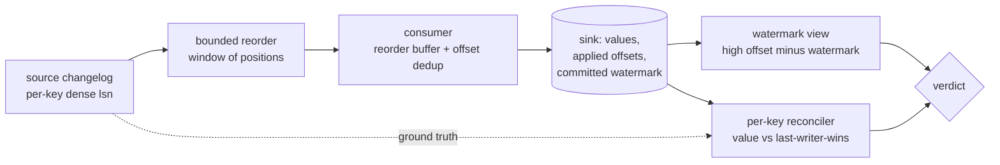
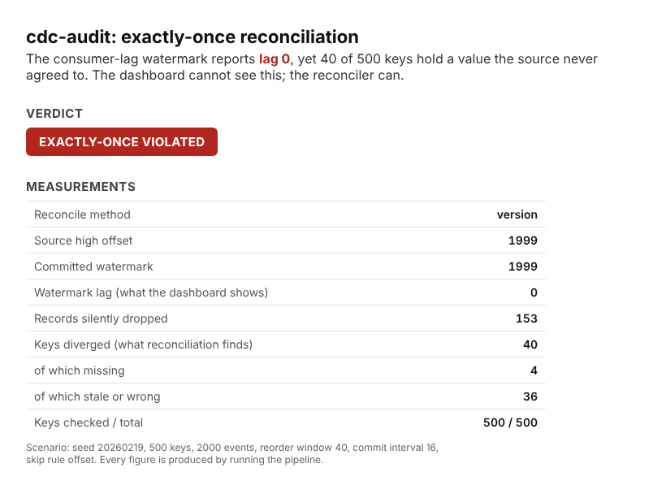

<div align="center">


**Audits a change-data-capture sink for exactly-once violations a consumer-lag dashboard cannot see, by reconciling against the source changelog per key instead of by offset.**


</div>

## The impossibility

Consumer lag is the source's high offset minus the committed watermark. It is the number on
every streaming dashboard, and it answers one question: how far behind is the consumer. It
structurally cannot answer a different question that looks the same from a distance: is every
row below the watermark actually there.

It cannot, because a watermark is a single offset and a sink is a set of keys. Storing the
highest applied offset throws away which offsets were applied. So a record that was reordered
behind the watermark and then dropped as a presumed duplicate leaves no trace in the lag: the
watermark still reaches the end, lag still falls to zero, and the dashboard still says caught up.

Three questions this answers that a lag dashboard cannot:

1. With the watermark reading zero, how many keys in the sink hold a value the source never
   agreed to.
2. Which shape of loss the watermark can see (loss at the tail) and which it is blind to (loss
   in the interior).
3. What the cheap completeness check, counting gaps in the offset sequence, costs on exactly the
   topics that use exactly-once: the ones with transactions.

## The uncomfortable numbers

On the shipped scenario (a seeded changelog of **2,000 events** over **500 keys**, delivered with
bounded reorder and consumed by an offset-deduplicating consumer):

- the consumer-lag dashboard **reports lag 0**: by its own measure the consumer is fully caught up;
- yet **40 of 500 keys** hold a value the source never wrote, **4 missing** and **36 stale**;
- and **153 records** were silently dropped on the way, a number that by itself overstates the
  harm, because most dropped records were later overwritten anyway. Only reconciliation by key
  tells you which drops actually mattered.

Every figure in this document is re-measured on each CI run by `tools/collect_metrics.py` and
verified against this prose by `tools/check_numbers.py`, which fails the build on a stale number.
The suite is **98 tests** at **100% line coverage**.

## Quickstart

Prerequisites: Python 3.11 or newer. No network, no Kafka, no credentials.

```bash
pip install -e .
cdc-audit --policy policy.toml          # prints the verdict, exits 1 on a violation
cdc-audit --policy policy.toml --report out.html   # also writes the HTML report
make verify                              # lint, tests, re-measure, number-check
```

`make verify` runs from a fresh clone with no network and is byte-identical on re-run.

## What the watermark cannot see: the blind spot

The audit runs the same stream two ways and compares what each view reports.

| view | what it reports | on the shipped stream |
|---|---|---|
| consumer-lag watermark | source high offset minus committed watermark | lag of 0 |
| per-key reconciliation | keys whose sink value differs from last-writer-wins truth | 40 of 500 keys wrong |

The watermark reaches the end of the log because the consumer did process every offset. It just
skipped some of them as presumed duplicates. The reconciler does not look at offsets at all; it
compares the materialised value of each key against the newest write the source holds for that
key, so a skipped latest write shows up as a wrong row no matter where the watermark sits.

## Loss location decides what the watermark sees

The watermark is not useless. It is blind to one specific shape of loss and sharp on another, and
saying which is what makes the blind spot precise rather than a slogan.

| loss shape | what happens to the watermark | shipped measurement |
|---|---|---|
| tail (newest offsets never arrive) | watermark cannot advance past the gap | lag of 50, 48 of 500 keys wrong |
| interior (a reordered record below the watermark is dropped) | watermark advances over it | lag 0, 40 of 500 keys wrong |

Tail loss moves the number the dashboard watches, so an operator catches it. Interior loss hides
under a zero. The entire tool exists for the second row.

## The cheap check and what it costs: offset gaps on a transactional topic

There is a tempting shortcut. Instead of reconciling by key, which needs the whole changelog and
O(keys) memory, just watch for holes in the offset sequence below the watermark. It needs no
changelog and almost no memory. It is also wrong on the topics most likely to use exactly-once.

A Kafka transaction commit marker consumes an offset without carrying a row, and log compaction
removes offsets whose keys were later superseded. Both leave legitimate holes. On a lossless
transactional version of the shipped topic, the offset-gap detector raises **99 false alarms**,
one per marker hole, while the per-key reconciler **raises 0 false alarms** on the same sink.

| detector | memory | needs changelog | false alarms on the transactional topic |
|---|---|---|---|
| offset-gap | O(1) | no | 99 marker holes flagged as loss |
| per-key version | O(keys) | yes | 0 false alarms |

The zero is not a measured rate that happened to come out empty. It is structural: the version
reconciler never inspects an offset, so a marker hole cannot raise an alarm, and a test pins that
invariant.

## The detection floor of a sampled reconciler

If a deployment cannot afford O(keys) memory and samples a fraction of keys instead, the loss it
can no longer guarantee to catch is exact and worth publishing next to the method. For a loss
confined to a single key, a reconciler that inspects 10% of keys **misses it 90% of the time**,
and one that inspects half the keys still misses it **50% of the time**. To catch a single-key
loss with 95% confidence you must inspect **95% of the keys**. Sampling buys memory and spends
detection, and the price is a probability, not a hand-wave.

## The bugs the measurement found

**Offset gaps are not loss on a transactional topic.** The first completeness check here counted
contiguous offsets and flagged every hole below the watermark as a lost row. Run against a topic
with transaction markers it raised an alarm per marker while nothing had been lost. The fix was to
reconcile by per-key version instead of by offset, which is the central design of the tool rather
than a patch. ADR-001 records it; `tests/test_war_story.py` pins it so it cannot come back quietly.

**A record count overstates harm as badly as a watermark understates it.** An early report headline
was "records dropped", which on the shipped stream is 153 and sounds catastrophic. Reconciliation
shows only 40 keys actually end up wrong, because 113 of those drops were intermediate writes a
later write overwrote anyway. The report now leads with keys diverged and keeps the record count as
context. ADR-004 states the last-writer-wins boundary this rests on.

## Architecture

<div align="center">

</div>

The source changelog is the ground truth. Delivery reorders within a bounded window. The consumer
holds a bounded reorder buffer and commits a watermark, deduplicating by offset. Two views then
read the sink: the watermark, which sees one subtraction, and the reconciler, which compares every
key against the source.



## Evidence

<div align="center">

</div>

The report above is produced by `tools/capture_screenshots.py` from the real HTML the tool emits;
the same script reads back the computed style of the verdict badge and fails if it is illegible, so
the headline cannot render invisibly. The demo below is a replay of captured stdout, paced by each
command's measured wall time, recorded by `tools/record_demo.py`.

<div align="center">

</div>

## The fixture

The changelog is seeded and committed to no file: `cdc_audit.source.generate_source` rebuilds it
byte for byte from the policy. It is deliberately awkward in three ways. Each key's version is dense
(increments by exactly one), so a missing version is unambiguous loss and not a naturally sparse
history. A small fraction of changes are deletes, so a key that should be absent is a distinct
failure from a key with a wrong value. And the transactional variant inserts offset holes where a
commit marker would sit, so the offset-gap detector has something real to trip on.

## What this cannot measure

This section is the point, not a footnote.

- **It is only as complete as the source log it is given.** The reconciler certifies that the sink
  matches the changelog. It cannot certify that the changelog itself captured every change at the
  database. If the source of truth is lossy, the audit inherits that blind spot.
- **Last-writer-wins hides lost intermediate writes.** A dropped write that a later write would have
  overwritten anyway leaves the steady-state value correct, so it is deliberately not counted as a
  divergence. A system that needs every intermediate state, not just the final one, needs a
  different oracle. ADR-004.
- **Sampling has a detection floor.** Below full reconciliation, a loss confined to few keys can
  pass, with the probability given above. ADR-005.
- **One logical partition.** The per-key version is a per-partition guarantee. A key that moves
  partitions under repartitioning needs a global clock, which is out of scope. See the Pivot.
- **The reorder model is synthetic.** Real reorder comes from consumer rebalances and producer
  retries, whose distribution differs from the seeded bounded-window model here. The offset
  -contiguity failure mode is identical; only the arrival-time shape differs. ADR-003.

## Layout, exit codes, reproduction

```
src/cdc_audit/      model, config, source, delivery, consumer, watermark, reconcile, report, cli
tests/              98 property-named tests
experiments/        four questions, each writing JSON to docs/experiments/
tools/              collect_metrics, check_numbers, render_diagrams, capture_screenshots, record_demo
docs/adr/           five architecture decision records
policy.toml         every knob, commented, loaded via stdlib tomllib
```

Exit codes carry the verdict, so a monitor can branch on them without parsing prose:

| code | meaning |
|---|---|
| 0 | exactly-once held: the sink reconciles against the source |
| 1 | divergence found: the audit ran and the answer is no |
| 2 | the tool could not answer: a bad policy, an unreadable file, an inconsistent log |

Keeping 1 and 2 apart is deliberate. A monitor that reads "the audit crashed" as "the data is fine"
is the same mistake this whole project is about.

Make targets:

```
make lint        ruff
make test        pytest with coverage
make receipts    re-measure every figure, then fail on any stale number
make verify      lint, test, receipts
make evidence    regenerate the diagram, screenshot and demo (needs the evidence extras)
```

`make verify` is the one command the quickstart promises. `check_numbers.py` guards each figure by
an anchor phrase rather than by bare digits, because a bare digit is found in a version string or a
heading and proves nothing; it matches the number together with two or three words around it.

## Tech stack

| technology | role here | why this one |
|---|---|---|
| Python standard library | model, pipeline, CLI | the core audit must reproduce every number with no extra installed, so the default path imports nothing beyond stdlib (tomllib, dataclasses, heapq, hashlib) |
| numpy (optional extra) | Monte Carlo cross-check of the sampling floor | used only to validate the closed-form probability, never on the path that produces a published number |
| ruff | lint | one fast tool for style and import hygiene, line length held at 100 |
| pytest with coverage | tests and the coverage figure | the count and coverage are read from junit and coverage json, not from a progress line |
| Playwright and Chromium (dev extra) | diagram, screenshot, demo | render the committed SVG and photograph the real report; kept out of CI so the JVM-free path is tested |

The five ADRs, whose titles advertise the thinking:

- [ADR-001](docs/adr/ADR-001-reconcile-by-version-not-offset.md): reconcile by per-key version, not by offset contiguity
- [ADR-002](docs/adr/ADR-002-model-the-watermark-faithfully.md): model the max-applied-offset watermark faithfully rather than fixing it
- [ADR-003](docs/adr/ADR-003-offline-seeded-simulation.md): an offline seeded simulation instead of an embedded Kafka
- [ADR-004](docs/adr/ADR-004-last-writer-wins-oracle.md): last-writer-wins as the correctness oracle, and what it cannot see
- [ADR-005](docs/adr/ADR-005-sampled-reconciliation-floor.md): sampled reconciliation and its detection floor

## The Pivot, and future work

Intentionally out of scope: **cross-partition global ordering**. The reconciler trusts a per-key
version that is monotonic within one logical partition. The moment a key can move partitions, under
repartitioning or a key-schema change, the per-partition version is no longer a total order for that
key and the oracle needs a global logical clock. The trigger to build it is the first scenario where
a key's history spans two partitions; until then a global clock is cost with no caught bug.

Future work, each with the first metric to watch:

- A Kafka transaction-aware source adapter, validated against a real broker in an integration lane
  outside `make verify`. First metric: false-alarm count on a real transactional topic, which should
  stay at 0 for the version reconciler.
- A streaming reconciler that bounds memory with a sketch rather than a sample. First metric: the
  detection floor at a fixed memory budget, compared against the exact floor published here.
- Delete-aware reconciliation that distinguishes a tombstone that arrived late from one that was
  lost. First metric: missing-key count split by cause.
